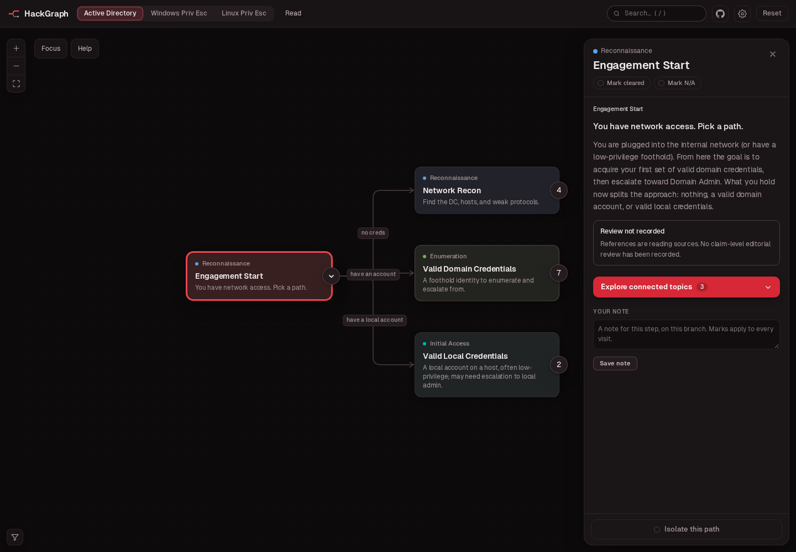

<div align="center">

# HackGraph

A visual notebook for learning how security concepts connect.

[](https://hackgraph.github.io/)
[](https://github.com/HackGraph/hackgraph.github.io/actions/workflows/deploy.yml)
[](LICENSE)



</div>

Explore 390 topics across Active Directory, Windows, and Linux. Progressive expansion, a readable branch list, keyboard navigation, search, and a static reference support different ways of studying. The application runs in the browser without runtime package dependencies.

The topic list adapts around the expanded card and keeps its focused choice visible after resizing. Help and Settings close when keyboard focus returns to the graph. The [overlay review](reports/OVERLAY_REVIEW.md) records the viewport checks and measured setup cost.

Graph panels explain the four shared labels with three scoped AI source comparisons and one project-defined convention. This vocabulary appears separately from the evidence for each individual connection.

Selected conceptual AI comparisons cover 264 claims across 124 entries: all 71 categories, eight start/goal overviews, and 45 technique-classified entries. Another 1,031 graph entries have no recorded claim-level comparison. The [verification report](reports/VERIFICATION.md) links the completed comparisons and records their scope; the [execution-context review](reports/EXECUTION_CONTEXT_REVIEW.md) fills six missing-reference gaps and the [KDC-account review](reports/KERBEROS_ACCOUNT_REVIEW.md) fills one more. The [Windows privilege review](reports/WINDOWS_PRIVILEGE_REVIEW.md) adds eighteen selected conceptual comparisons in nine further entries. The [Linux configuration review](reports/LINUX_CONFIGURATION_REVIEW.md) adds sixteen comparisons in eight further entries. The [missing-reference review](reports/MISSING_REFERENCE_REVIEW.md) adds seventeen conceptual comparisons in the final eight uncited technique entries. The [citation corrections](reports/CITATION_RETIREMENT_REVIEW.md) retire misleading references without adding claim comparisons. The [reading guide](about.html) explains source labels and current coverage. A browsing trail is navigation history, not evidence of a feasible sequence.

The [glossary](glossary.html) has 91 definitions, all with an explicit AI source comparison and supporting source sections. These records cover definitions and aliases only. They identify the reviewer and date, become stale when the wording or citations change, and never count as reviewed graph entries. See the [glossary review report](reports/GLOSSARY_REVIEW.md) for corrections and the [human-review handoff](reports/HUMAN_REVIEW.md) for the complete editorial inventory.

## Run and verify

Use Node 22 or newer. Packages are development tools only.

```bash
npm ci
npx playwright install chromium firefox webkit
npm run dev
```

Open <http://127.0.0.1:5173>. Verification and staging:

```bash
npm test                    # unit, jsdom, browser checks, then artifact verification
npm run check:content       # evidence coverage and structural inventory
npm run references          # regenerate committed HTML and sitemap
npm run build               # regenerate references and stage public files in .site/
npm run verify:build        # compare the existing .site/ with its inputs; no rebuild
```

Browser tests include the staged artifact. Pages CI verifies its full file list, bytes, source digest, and build metadata before uploading `.site/`. The publication policy excludes development packages, tests, reports, and authoring tools. A build contains a content digest and date; only a clean checkout receives a commit link. The build date is not a knowledge-review date. See [artifact verification](reports/ARTIFACT_VERIFICATION.md) for the repeatable checks and their limits.

Optional research and freshness checks:

```bash
npm run layout:compare      # generic fixtures: current solver versus ELK
npm run layout:geometry     # connector crossings and a second ELK configuration
npm run layout:sequences    # repeated expansion/collapse on varied generic graphs
node tools/render-lab.mjs   # local server required; frame samples, axe, screenshots
npm run render:expansion    # local server required; 25/100/250-child setup measurements
node tools/sidebar-lab.mjs  # local server required; first disclosure, closing and reopening
npm run check:refs          # network audit; writes reports/reference-availability.json
npm run check:taxonomy      # network audit of mapped and cited ATT&CK technique/tactic IDs
npm run references:status   # explicitly snapshot the latest complete URL audit
npm run review:inventory    # regenerate the editorial JSON/CSV inventory
```

Network audits are separate from deterministic CI. Blocked HTTP requests are inconclusive; unreachable/not-found/unavailable responses fail the scheduled link audit. Taxonomy checks fail on missing, deprecated, or revoked identifiers and do not silently remap content. To deliberately refresh the recorded snapshot, run `node tools/check-taxonomy.mjs --write` and review its diff.

The [defensive knowledge-model review](reports/DEFENSIVE_REVIEW.md) records the resolved ATT&CK identifier migration, publication-location inspections, access diagnostics, and graph-model findings. The [expanded taxonomy audit](reports/TAXONOMY_CITATION_REVIEW.md) covers 117 mapped or cited technique/tactic identifiers, all active in the recorded ATT&CK 19.2 dataset. This status is separate from reviewing the claims attached to those identifiers. The publication provenance passes, including the [article/database review](reports/ARTICLE_PROVENANCE_REVIEW.md), now retain 732 classifications across 484 active exact URLs after the [citation corrections](reports/CITATION_RETIREMENT_REVIEW.md); another 229 references have explicit source-type labels. All active graph references have recorded types. Confirmed citation-destination problems appear in graph panels, reading pages and the editorial inventory. Publication classifications preserve the separate claim-review records.

## Contributing

Maps live in `src/data/`; `src/data/schema.d.ts` documents their fields. New maps also need static-page metadata in `tools/gen-reference.mjs` and their reading page in the publication list in `tools/site-artifact.mjs`. See [CONTRIBUTING.md](CONTRIBUTING.md) for source records and checks, [the implementation plan](IMPLEMENTATION_PLAN.md) for acceptance evidence, and [release notes](RELEASE_NOTES.md) for limitations.

The domain adapter preserves authored notes, applicability and aliases. Generic layout, camera, and navigation behavior live in `engine/`. Do not infer applicability from missing tags or extend existing ranges when adding releases to the catalog.

## Acknowledgements

The mindmap format was inspired by the [Orange Cyberdefense mindmaps](https://github.com/Orange-Cyberdefense/ocd-mindmaps). Individual entries retain their original references and tool credits. Source types remain unclassified until explicitly documented.

[MIT](LICENSE).
